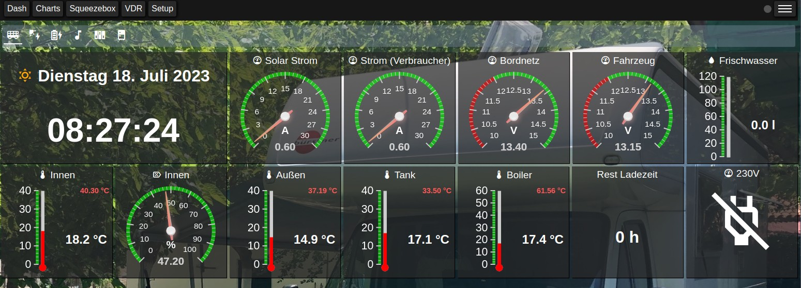
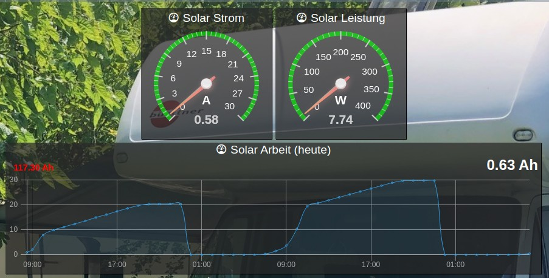
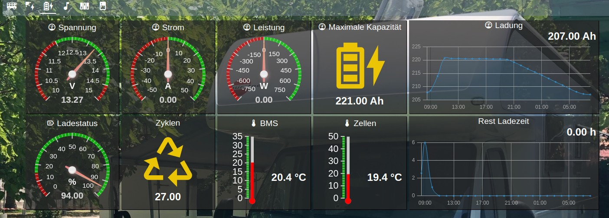
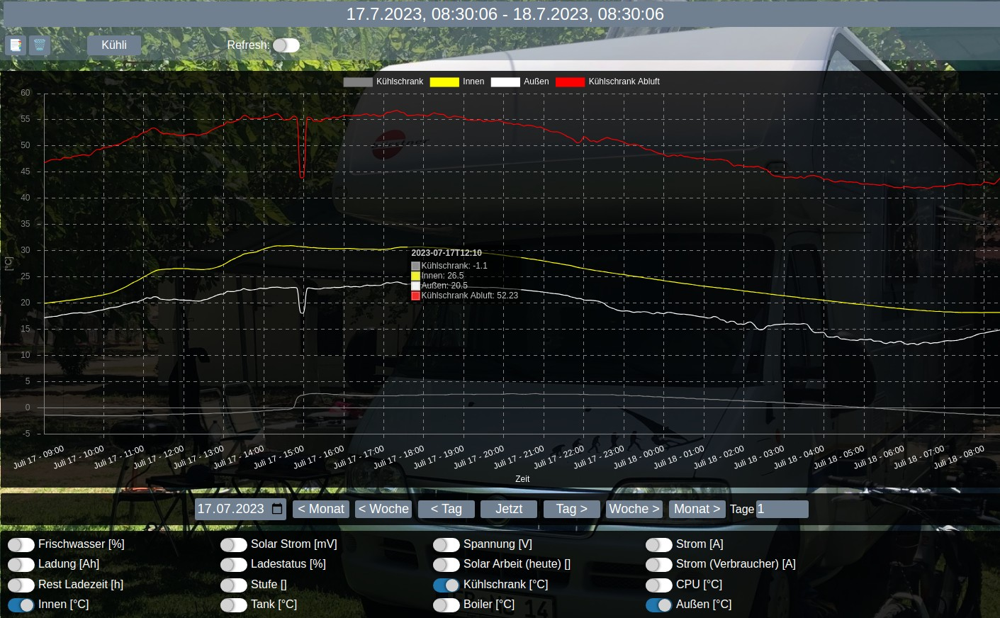
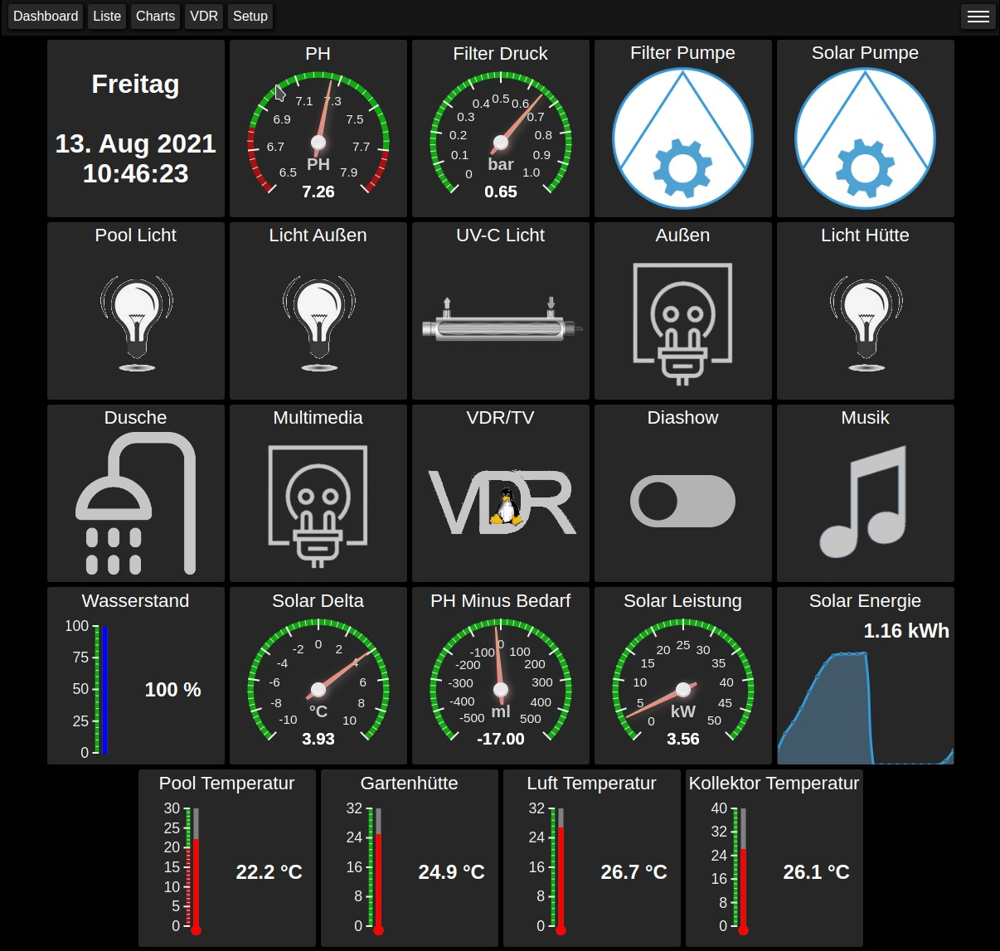

# Linux - Home Control Daemon (homectld)

Written by: *Jörg Wendel (linux at jwendel dot de)*
Project page: https://github.com/horchi/linux-homectld

homectld is a home control daemon for Linux (Raspberry Pi, Odroid or any other Linux box). It collects the
values of many kinds of sensors and devices (GPIO, One Wire, i2c, MQTT, deCONZ / Zigbee, HomeMatic, Bluetooth
devices via ESP32, ...), stores them in a MariaDB / MySQL database and switches lights, blinds and outputs by
time, sun times, rules and Lua scripts. The integrated WEB interface offers dashboards, charts, the setup of
all sensors and many more.

It is used as camper control (motorhome: battery, tanks, gas, refrigerator, GPS tours, tire pressure, LTE
router) as well as home and pool control.

## License
This code is distributed under the terms and conditions of the GNU GENERAL PUBLIC LICENSE. See the file LICENSE for details.

## Donation
If you like the project and want to support it

# Features

## Supported Sensors / Interfaces

- GPIO of Raspberry Pi or Odroid (tested with Odroid N2+)
- Deconz https://www.dresden-elektronik.de/funk/software/deconz.html (lights, groups, switches, motion and other Zigbee sensors) - see [deCONZ](doc/deconz.md)
- OpenWeatherMap https://openweathermap.org/
- NodeRed - interface from and to NodeRed
- Growatt PV Inverter via https://github.com/OpenInverterGateway/OpenInverterGateway
- Rtl433 wireless sensors - see [Hardware](doc/hardware.md#433-mhz-radio-sensors-rtl-433)
- One Wire Sensors - see [Hardware](doc/hardware.md#one-wire-sensors)
- Support of some i2c bus circuits like ADS1115, MCP23017, DHT20 and the TCA9548A multiplexer - see [Hardware](doc/hardware.md#i2c-bus)
- Arduino(s) with analog and digital inputs via MQTT
- Thetford refrigerator via CI bus - see [thetford/README.md](thetford/README.md)
- BMS Interface (Battery Management System) like this https://www.lithiumbatterypcb.com/product/4s-lifepo4-battery-bluetooth-bms-with-100a-constant-discharge-current-for-12v-lfp-battery-pack/
  as used for example for the LIONTRON LiFePO4
- Supports the RS485 Bus and the 'Simple Serial Display' interface of Votronic
- Supports the VE.Direct-HEX-Protocol-Phoenix-Inverter protocol of Victron devices
- Act as frontend of LMS (Logitech Media Server)
- Act as a remote control of the VDR (Linux Video Disc Recorder)
- Script adapter/converter interface for custom MQTT messages - to be able to integrate almost all sensors that deliver data via MQTT
- Windy App / Windy App Map to display wind data from https://windy.app/de/widgets - see [Windy App](doc/windy.md)
- Control of WiFi management via nmcli client integrated in the web interface
- Control of system services via systemd integrated in the web interface
- Display and filtering of rsyslog logs files integrated in the web interface
- HomeMatic blind actuators directly via a CUL USB stick
  or by using NodeRed as bridge to the CCU (alternative to the CUL stick) - see [HomeMatic](doc/homematic.md)
- Light and blind control by fixed times or sun times,
  rules for switches and motion sensors, shading of the blinds - see [Light and Blind Control](doc/lights.md)
- Tire pressure (TPMS) of Bluetooth valve caps via an ESP32 and MQTT - see [TPMS](doc/tpms.md)
- GPS position, recording of tours with fuel stops, costs and consumption, TV dish alignment - see [GPS Tours](doc/gps.md)
- openHASP touch panels as wall or vehicle display - see [HASP Panel](doc/hasp.md)
- Garmin Connect activities - see [Garmin Activities](doc/garmin.md)
- Lua scripts for calculated values and outputs - see [Lua Interface](doc/lua.md)
- Dashboards with many widget types, own HTML widgets, charts, alerts - see [WEB Interface](doc/webif.md)

# Quick start

1. Install the prerequisites, the database and the build dependencies, build and install homectld -
   see [Installation](doc/installation.md)
2. `systemctl enable --now homectld`
3. Open the WEB interface `http://<your-ip>:61109` (user `homectl`, password `homectl`) and activate the
   sensors in *Setup -> IO Setup* - see [WEB Interface](doc/webif.md)

# Documentation

| Topic | Content |
|-------|---------|
| [Installation](doc/installation.md) | prerequisites, database, build and install, first start, backup, MySQL hints |
| [WEB Interface](doc/webif.md) | login, URL parameters, iOS home screen app, first steps, script sensors |
| [Hardware and Interfaces](doc/hardware.md) | One Wire, i2c bus, BMS, RTL-433, CI bus, GPIO, hardware of the pool control |
| [deCONZ (Zigbee)](doc/deconz.md) | setup, API key, lights / groups / sensors, battery, invalid sensors |
| [Light and Blind Control](doc/lights.md) | deCONZ lights / groups / switches / motion sensors, outputs, blinds: sun times, time control, rules, shading |
| [HomeMatic](doc/homematic.md) | blind actuators via CUL stick (hmmqtt) or Node-RED / CCU |
| [Tire Pressure (TPMS)](doc/tpms.md) | Bluetooth valve caps via ESP32 |
| [GPS Tours](doc/gps.md) | live position, tour recording, ferries, dish alignment, fuel stops and consumption |
| [HASP Panel](doc/hasp.md) | openHASP touch panel as display |
| [Garmin Activities](doc/garmin.md) | activities of a Garmin Connect account |
| [Lua Interface](doc/lua.md) | scripts for calculated values and outputs |
| [Windy App](doc/windy.md) | wind / weather widgets of windy.app |
| [Stand Alone Server](doc/standalone-server.md) | camper setup: network, DNS/DHCP, IP masquerading, LTE modem |
| [Bluetooth Audio](README-BT.md) | Bluetooth audio setup (BR/EDR devices) |
| [TASMOTA](TASMOTA.md) | I/O boards with TASMOTA |

Further READMEs of the components: [homematic](homematic/README.md), [tpms](tpms/README.md),
[openHASP](openHASP/README.md), [gps.u-blox](gps.u-blox/README.md), [garmin](garmin/README.md),
[thetford](thetford/README.md)

# Some Screenshots

## As Camper Control

## As Pool Control

*Click on a screenshot for the full size.*

# Disclaimer

USE AT YOUR OWN RISK. No warranty.
This software is a private contribution and not to any products and can also cause unintended behavior. Use at your own risk!
THE SOFTWARE IS PROVIDED "AS IS", WITHOUT WARRANTY OF ANY KIND, EXPRESS OR IMPLIED, INCLUDING BUT NOT LIMITED TO THE WARRANTIES OF MERCHANTABILITY, FITNESS FOR A PARTICULAR PURPOSE AND NONINFRINGEMENT. IN NO EVENT SHALL THE AUTHORS OR COPYRIGHT HOLDERS BE LIABLE FOR ANY CLAIM, DAMAGES OR OTHER LIABILITY, WHETHER IN AN ACTION OF CONTRACT, TORT OR OTHERWISE, ARISING FROM, OUT OF OR IN CONNECTION WITH THE SOFTWARE OR THE USE OR OTHER DEALINGS IN THE SOFTWARE.
The software was created for personal use, it's published here for free under the GPLv2.
The construction of the required hardware, especially in the handling of mains voltage (230V, 110V, ...), is carried out on one's own responsibility, local guidelines and regulations must also be observed especially in connection with water and pool!
All explanations about the hardware are only indications of how it is technically feasible, security and legal provisions are not discussed here!
